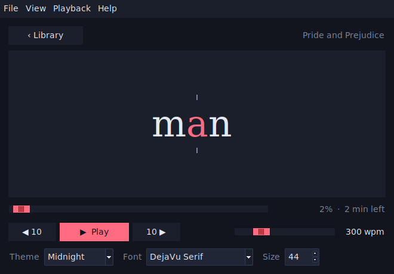

# GutenRead

Read public-domain classics faster. GutenRead flashes a book one word at a time, with the focus letter
highlighted, so your eyes stay still and the words come to you. Pick from the Project Gutenberg library or open
your own text file.



## Features

- **Built-in library.** Search Project Gutenberg's English catalogue and start reading in one click.
- **Your speed.** 100 to 1000 words per minute, with optional longer pauses at punctuation and long words.
- **Comfortable to read.** Six themes, a choice of fonts, and adjustable text size. Long words shrink to fit.
- **Easy to control.** Play and pause, skip back or forward, drag to any point, and see the time left.
- **Picks up where you left off.** Your place in each book and your settings are saved.
- **Light and private.** No account and no tracking. Downloaded books are cached on your computer.

## Download

Get the latest build for your system from the [Releases page](../../releases/latest):

| System | File | Notes |
|---|---|---|
| Windows | `GutenRead-windows.exe` | If SmartScreen warns you, choose **More info → Run anyway**. |
| macOS (Apple silicon) | `GutenRead-macos.zip` | Unzip and open the app. When macOS blocks it, go to **System Settings → Privacy & Security**, scroll down, and click **Open Anyway**. |
| Linux | `GutenRead-linux.tar.gz` | Extract, then run `./GutenRead`. |

The builds are unsigned, which is why the first launch shows a warning.

## Run from source

You need Python 3.9 or newer with Tkinter. It is included with the python.org installers; on Debian or Ubuntu run
`sudo apt install python3-tk`. GutenRead has no other dependencies.

```bash
python run.py
```

## Using GutenRead

Choose a book in the library and press **Read** (or double-click it). Use **Open file…** for any `.txt` file on
your computer, and **Continue** to return to your last book.

| Action | Key |
|---|---|
| Play / pause | `Space`, or click the reading area |
| Back / forward 10 words | `←` / `→` |
| Faster / slower | `↑` / `↓` |
| Larger / smaller text | `Ctrl` `+` / `Ctrl` `-` (`Cmd` on macOS) |
| Back to the library | `Esc` or `Ctrl+L` |
| Open a text file | `Ctrl+O` |
| Quit | `Ctrl+Q` |

Themes, fonts, and the punctuation and focus-letter options are also in the **View** menu.

## Where your data goes

GutenRead talks to two services only: [Gutendex](https://gutendex.com) for searching the catalogue and
[Project Gutenberg](https://www.gutenberg.org) for the book text. Settings, progress, and downloaded books are
stored in `~/.gutenread/` (set `GUTENREAD_HOME` to change this).

Project Gutenberg asks automated programs to be gentle, so GutenRead downloads a single book per click, caches it, and
waits at least two seconds between downloads. If you want many books at once, use one of their
[mirrors](https://www.gutenberg.org/help/mirroring.html) instead of this app.

## Development

```bash
python -m unittest discover -s tests     # run the tests
```

Project layout:

```
gutenread/
  app.py        window, catalogue view and reader view
  catalog.py    Gutendex search and book download
  textproc.py   cleaning, word timing, focus letter
  themes.py     colour themes
  store.py      settings and progress
```

### Building an executable

PyInstaller builds for the system it runs on:

```bash
pip install -r requirements-dev.txt
pyinstaller --noconfirm --name GutenRead --windowed run.py   # add --onefile on Windows and Linux
```

The GitHub Actions workflow in `.github/workflows/build.yml` builds all three platforms. Run it manually from the
**Actions** tab, or push a version tag (for example `v0.1.0`) to build and publish a release.

## Acknowledgements

Books are provided by [Project Gutenberg](https://www.gutenberg.org), and catalogue data by the community-run
[Gutendex](https://github.com/garethbjohnson/gutendex) API. GutenRead is not affiliated with either project. Most of the texts are in the public domain in
the United States; check the rules where you live.

## License

[MIT](LICENSE)
